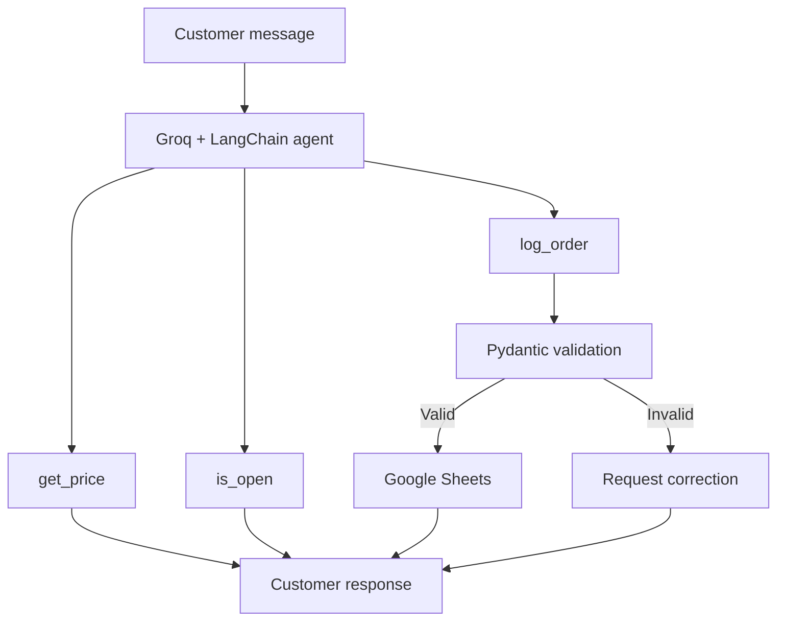

# 🌸 Preety Phool Flowers — AI Order Agent

**AI Agents Workshop | Level 2 | Day 4 — Tools, Structured Output and Google Sheets**

An AI-powered customer support and order management assistant for [Preety Phool Flowers](https://preety-phool-flowers.vercel.app/). The project extends a conversational agent with Python tools, structured data validation and automatic order logging to Google Sheets.

## Features

- Natural-language customer support in English and Telugu.
- Bouquet price calculations and business-hours enquiries.
- Conversation history for multi-turn interactions.
- Pydantic validation of customer order details.
- Automatic saving of complete demo orders to Google Sheets.
- Handling of invalid products, missing details, invalid quantities and API errors.
- Agent execution traces and model/tool call counts.

## Technology Stack

| Technology | Purpose |
| --- | --- |
| Python / Google Colab | Development and execution |
| Groq (`openai/gpt-oss-20b`) | Language model |
| LangChain | Agent orchestration and tool calling |
| Pydantic | Structured output and validation |
| gspread / Google Sheets | Order storage |

## Project Structure

```text
.
├── Day4_PreetyPhool.ipynb   # Main Google Colab notebook
├── tests.csv                # Customer test cases and expected results
├── business_facts.txt       # 20 draft business facts for Day 5
└── README.md                # Project documentation
```

## Getting Started

1. Open [Google Colab](https://colab.research.google.com/).
2. Upload `Day4_PreetyPhool.ipynb` using **File → Upload notebook**.
3. Obtain your own Groq API key from the [Groq Console](https://console.groq.com/keys).
4. In Colab, open **Secrets** (key icon), create a secret named `GROQ_API_KEY`, paste your key and enable notebook access. Never commit your API key to GitHub.
5. Run the notebook cells in order. The setup cell installs the required packages:

   ```python
   !pip install -q langchain langchain-groq gspread pydantic
   ```

6. Authenticate your Google account when prompted. The notebook creates or opens **Preety Phool Orders - DEMO** and prints its URL.
7. Run the agent, structured-output tests, invalid-order tests and tool comparison cells. Open the sheet to verify the saved demo orders.
8. Run the optional interactive chat cell to enter your own questions. Type `exit` to stop.

## Agent Workflow



## Available Tools

| Tool | Function |
| --- | --- |
| `get_price(item, qty)` | Calculates total price and rejects unknown products or quantities below one. |
| `is_open(day)` | Returns configured opening hours for a weekday. |
| `log_order(name, item, qty, date, gift_note)` | Validates and saves a complete demo order; gift note is optional. |

## Demo Catalogue

| Product | Unit price |
| --- | ---: |
| Rose bouquet | ₹499 |
| Mixed flower bouquet | ₹699 |
| Sunflower bouquet | ₹599 |

Demo hours: Monday–Saturday, 9 AM–8 PM; Sunday, 10 AM–6 PM.

## Example Interaction

**Customer:** Hi, I'm Ravi. Please book 2 rose bouquets for 30 November with a Happy Birthday gift note.

**Expected result:** The agent validates the order, calculates ₹998, saves a row and confirms the order if saving succeeds.

Example Google Sheets record:

| name | item | qty | date | gift_note | total |
| --- | --- | ---: | --- | --- | ---: |
| Ravi | rose bouquet | 2 | 30 November | Happy Birthday | 998 |

## Day 4 Student Assignment (30%)

- Define tools with clear names, type hints and docstrings.
- Define an `Order` Pydantic model and extract structured records from five messy customer messages.
- Connect a Google Sheet and implement an order-saving tool.
- Compare a vaguely named `tool1` with the restored `get_price` tool.
- Inspect the execution trace and count model calls and tool calls.
- Test unknown products, missing dates and zero quantities; export test results to `tests.csv`.
- Prepare 20 draft business facts for the Day 5 RAG exercise.

## Testing and Limitations

The bundled `tests.csv` contains expected outcomes, not verified execution results. Run the notebook with valid credentials to obtain actual results and verify the Google Sheet. The tests can write demo orders; rerunning them can create additional rows. Prices, catalogue, opening hours and business policies are illustrative and must be verified with the owner before real use. The agent is not connected to live website inventory, payments or delivery services. It is a workshop prototype, not a production ordering system.

## Future Enhancements

- Retrieval-Augmented Generation (RAG) using verified business facts.
- Live catalogue and inventory integration.
- Owner approval and duplicate-order protection.
- Website chatbot integration.

---

Built as part of the AI Agents Workshop — Day 4, applying tool calling, structured output and Google Sheets integration to a flower business use case.
